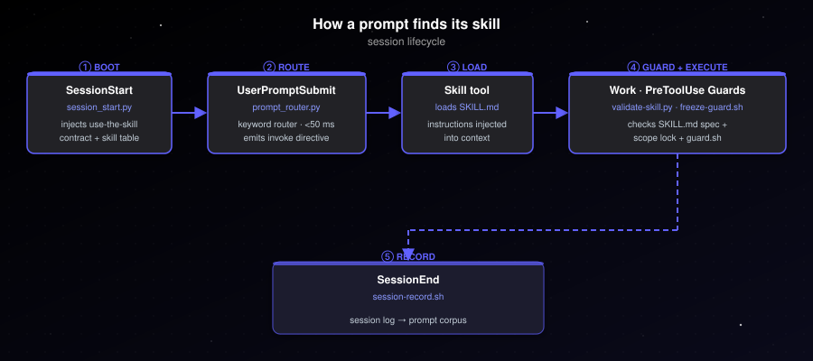

<p align="center"></p>

Gal's personal operating system for Claude Code — one repo, two plugins: `sir-albert` (skills) and `kb` (knowledge base).

## What's inside

<p align="center"></p>

28 skills across 5 categories, namespaced `/sir-albert:<skill>` or `/kb:<skill>`. Full index in [`REGISTRY.md`](REGISTRY.md).

## How a prompt finds its skill

<p align="center"></p>

- **Boot** — `session_start.py` injects the use-the-skill contract (`hooks/HOOK_CONTEXT.md`) and the core skill table into every session.
- **Route** — `prompt_router.py` (UserPromptSubmit hook) matches keywords in <50 ms, no LLM; emits `invoke /sir-albert:<skill>`. Ignores task notifications and system reminders.
- **Load** — the Skill tool reads `SKILL.md` and injects its instructions into context.
- **Guard** — PreToolUse hooks run before every tool call: `validate-skill.py` (SKILL.md spec), `freeze-guard.sh` (scope lock), `~/.claude/hooks/guard.sh` (blocks destructive commands).
- **Record** — `session-record.sh` writes the session log to the prompt corpus.

## Layout

```
sir_albert/
  .claude-plugin/marketplace.json   # lists both plugins
  plugins/
    sir-albert/                     # skills library
      .claude-plugin/plugin.json
      skills/
        core/       # brainstorm · plan · execute · debug · build · handoff · resume · decide · freeze · init · retro
        dev/        # create-skill · git-guardrails · github-repo-analyzer · prototype · readme-svg-generator
        packs/      # gtm-gate · ga4-regex · data-review · monday-data-viz-vibe · hubspot-safety · n8n-triage
        docs/       # monday-brand-guidelines · monday-presentation-v2 · to-prd
        biz/        # slack-in-my-voice · linkedin-in-my-voice · monday-mops-triage
        _archive/
      hooks/        # session_start.py · prompt_router.py · validate-skill.py · freeze-guard.sh · guard.sh · session-record.sh
      tools/
      tests/
      os/
    kb/                             # knowledge base engine
      .claude-plugin/plugin.json    # name: "kb"
      commands/   # wiki-init · wiki-compile · learn-capture
      skills/     # wiki-query · kw-compound · learn-recall · learn-research
      hooks/ lib/ tools/ templates/ tests/
  raw/  wiki/  wiki-schema.md       # KB data for this repo
  docs/  .memory-bank/  README.md  REGISTRY.md
```

## Loading (this machine)

Plugins load **live** via `--plugin-dir` (no cache copy; edits take effect immediately):

```bash
# ~/.zshrc alias (active)
alias claude='claude --plugin-dir /Users/galta/Development/sir_albert/plugins'
```

Every skill is namespaced: `/sir-albert:<skill-name>` or `/kb:<skill-name>`. See [`REGISTRY.md`](REGISTRY.md) for the full index.

## Loading (new machine)

```bash
claude plugin marketplace add /path/to/sir_albert
claude plugin install sir-albert@sir-albert
claude plugin install kb@sir-albert
bash plugins/sir-albert/bootstrap.sh
```

A plugin can't install `CLAUDE.md` or user-level hooks, so `bootstrap.sh` does the machine setup once (every step is idempotent and backs up what it replaces):

- adds the `--plugin-dir` alias to `~/.zshrc` (live edits)
- **asks** whether to use Sir Albert's `CLAUDE.md`; yes → `~/.claude/CLAUDE.md` becomes a one-line `@import` of `os/CLAUDE.global.md` (old file → `CLAUDE.md.backup-w3`). Non-interactive: `SIR_ALBERT_CLAUDE_MD=yes|no`
- symlinks `guard.sh` to `~/.claude/hooks/` and registers it as a `PreToolUse` hook in `~/.claude/settings.json`

Without the alias, rely on `claude plugin update` after each version bump.

## Knowledge Base pipeline

```
raw/ (source drop zone)
  ↓  /kb:wiki-compile
wiki/ (sources/ · entities/ · concepts/ · comparisons/)
  ↑  /kb:wiki-query reads     /kb:kw-compound writes back to raw/
```

See [`REGISTRY.md`](REGISTRY.md#knowledge--knowledge-management) for skill trigger phrases.

## Adding a new skill

Use `/sir-albert:create-skill` — it scaffolds, validates, and runs a scored eval loop. `validate-skill.py` checks every SKILL.md write automatically. Add a row to [`REGISTRY.md`](REGISTRY.md). The skill goes live immediately via `--plugin-dir`.
